<div align="center">


# WithRun

**내 주변 러닝 코스를 찾고, 같은 코스의 이전 기록에 도전하는 러닝 앱**

현재 위치와 러닝 선호도에 맞는 코스를 추천하고, 러닝 중에는 GPS와 Wear OS 데이터를 화면에 표시합니다.


</div>

## 목차

- [서비스 소개](#서비스-소개)
- [핵심 기능](#핵심-기능)
- [주요 기여](#주요-기여)
- [시스템 아키텍처](#시스템-아키텍처)
- [기술 스택](#기술-스택)
- [로컬 실행](#로컬-실행)
- [프로젝트 구조](#프로젝트-구조)
- [협업 규칙](#협업-규칙)

## 서비스 소개

WithRun은 낯선 동네에서도 평소 달리는 거리와 난이도에 맞는 코스를 찾을 수 있도록 만든 팀 프로젝트입니다. 원하는 길이 있다면 **자유 러닝**으로 기록해 코스로 저장하고, 추천받은 길을 달리고 싶다면 **일반 러닝**으로 코스 안내를 받을 수 있습니다. **고스트 러닝**에서는 같은 코스의 리더보드에서 상대를 골라 해당 완주 기록과 겨룹니다.

러닝을 마치면 활동 캘린더에서 날짜별 기록을 확인합니다. 일일 거리, 주간 러닝 일수, 고스트 승리 조건을 달성하면 포인트가 쌓이고, 리워드 뽑기에 사용할 수 있습니다.

<p align="center">
  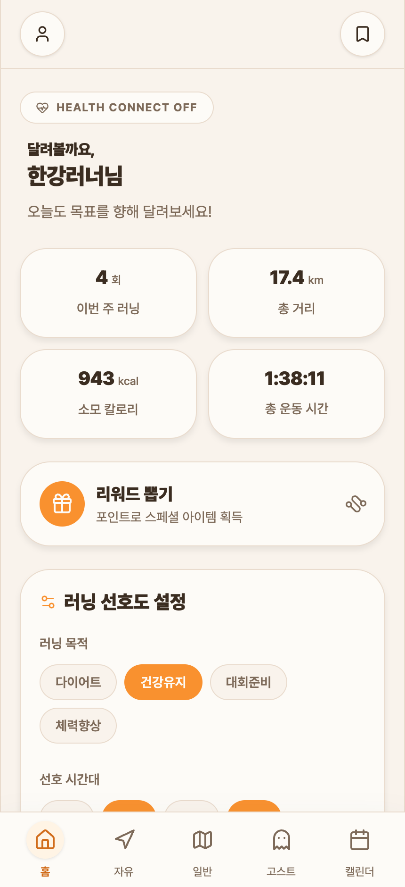
  <br /><sub>시연 화면 · 홈의 주간 활동 요약과 러닝 선호도</sub>
</p>

## 핵심 기능

### 주변 코스 탐색과 맞춤 추천

현재 위치를 기준으로 공식 코스와 커뮤니티 코스를 탐색합니다. 거리, 난이도, 코스 유형으로 필터링하고 관심 코스를 북마크할 수 있습니다. 추천 점수는 출발지까지의 거리, 러닝 선호도와 코스 특성의 유사도, 리뷰 평가, 공통 코스 이용 이력을 바탕으로 계산합니다. [추천 점수 계산 코드](was/src/main/java/kr/withrun/was/domain/course/service/recommendation/HybridRecommendationService.java)

<p align="center">
  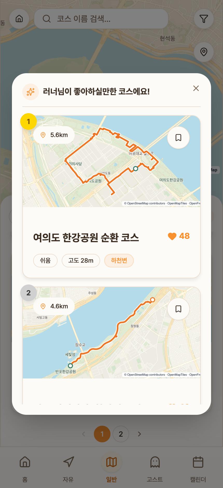
  <br /><sub>맞춤 코스 추천</sub>
</p>

### 자유 러닝과 일반 러닝

자유 러닝은 휴대폰 GPS로 달린 경로를 기록합니다. 완료한 경로를 개인 코스로 보관하거나 커뮤니티에 공개할 수 있습니다. 일반 러닝은 선택한 코스를 따라 체크포인트 진행 상황을 보여주고, 방향 전환을 음성으로 안내하며 코스를 벗어나면 경고합니다. [자유 러닝 흐름](web/docs/free-run-flow.md) · [코스 이탈 감지](web/docs/normal-run-course-deviation.md)

<table>
  <tr>
    <td align="center">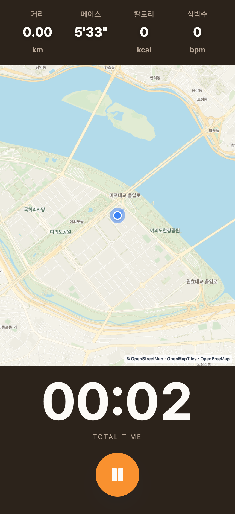<br /><sub>자유 러닝</sub></td>
    <td align="center">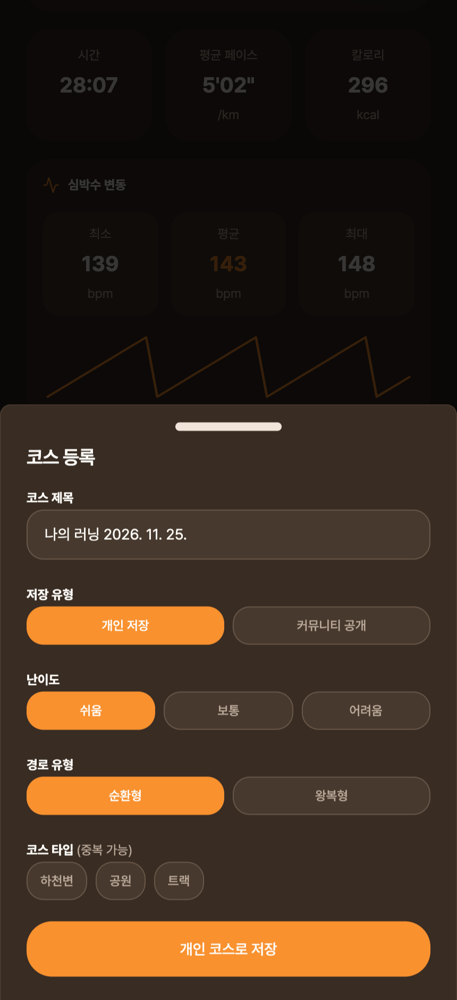<br /><sub>러닝 경로를 코스로 저장</sub></td>
    <td align="center">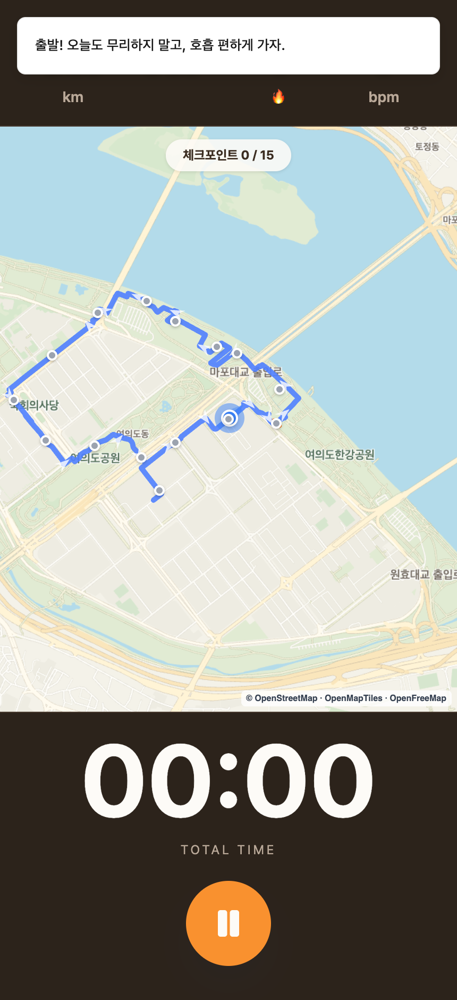<br /><sub>일반 러닝</sub></td>
  </tr>
</table>

### 고스트 러닝

같은 코스의 리더보드에서 도전할 기록을 선택합니다. 앱은 상대의 완주 시간에 맞춰 코스 위 고스트 위치를 표시하고, 러닝이 끝나면 대결 결과를 보여줍니다.

<table>
  <tr>
    <td align="center">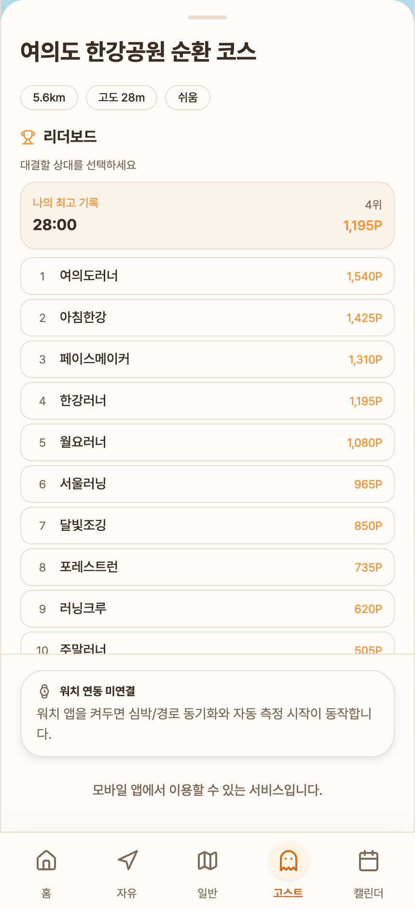<br /><sub>코스별 리더보드</sub></td>
    <td align="center">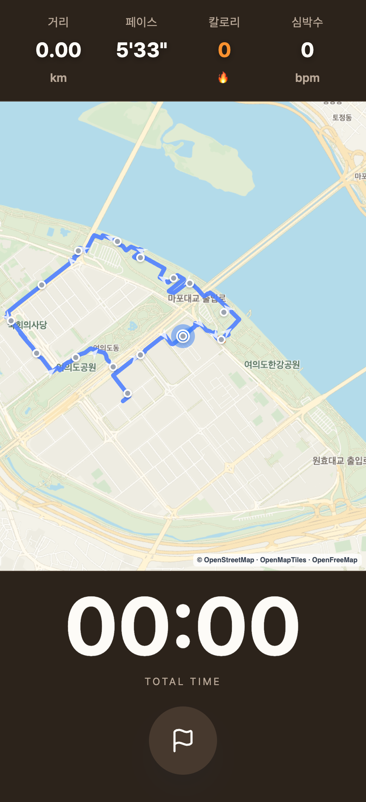<br /><sub>고스트 대결</sub></td>
  </tr>
</table>

### 활동 캘린더와 러닝 기록

월별 러닝 횟수와 누적 거리를 보고, 날짜를 선택해 해당 일자의 기록을 확인합니다. 전체 기록은 스크롤할 때 다음 페이지를 불러옵니다. 상세 화면에서는 경로, 페이스, 심박수 등 세션에 저장된 측정값을 볼 수 있습니다. [캘린더 화면과 데이터 흐름](web/docs/calendar-flow.md)

<table>
  <tr>
    <td align="center">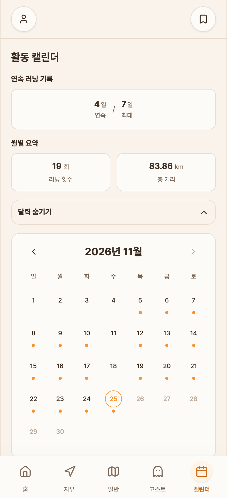<br /><sub>월별 활동 캘린더</sub></td>
    <td align="center">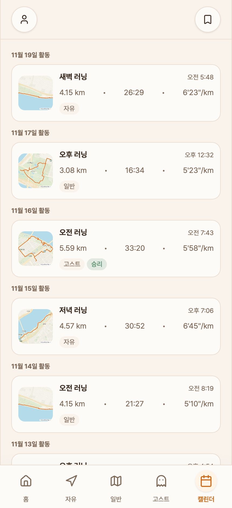<br /><sub>전체 러닝 기록</sub></td>
  </tr>
</table>

### 포인트와 리워드

일일 누적 거리, 주간 러닝 일수, 고스트 승리 조건에 따라 포인트를 받습니다. 포인트를 사용해 리워드 카드를 뽑고, 획득한 아이템과 포인트 내역을 확인할 수 있습니다.

<table>
  <tr>
    <td align="center">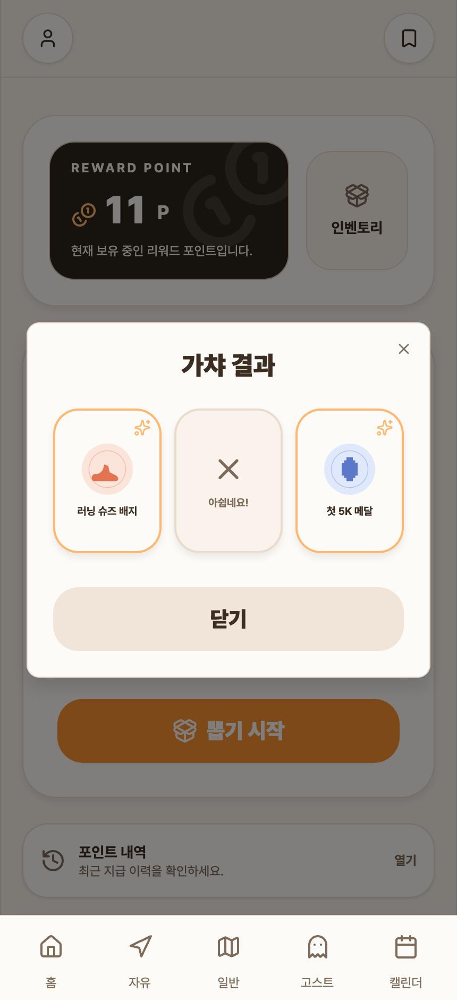<br /><sub>리워드 뽑기 결과</sub></td>
    <td align="center">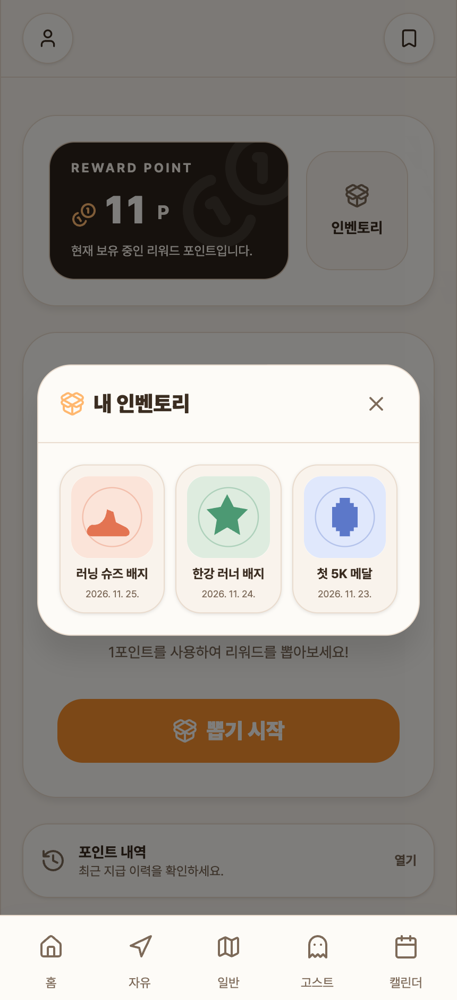<br /><sub>아이템 인벤토리</sub></td>
  </tr>
</table>

## 주요 기여

**강지석 · 백엔드**

| 영역 | 담당 작업 |
| --- | --- |
| [코스 탐색](#주변-코스-탐색과-맞춤-추천) | GPS 기준 주변 코스 조회, 코스 상세·필터 조회, 좋아요·북마크 API 구현 |
| [러닝 세션과 고스트](#고스트-러닝) | 세션 시작·종료 API, GPS 샘플 저장, 고스트 GPS 샘플 응답과 완주 세션의 리더보드 등록 처리 |
| [활동 캘린더와 기록](#활동-캘린더와-러닝-기록) | 월별 활동 요약과 과거 기록 조회 API 구현. 시작 시각과 세션 ID를 함께 커서로 사용해 시작 시각이 같은 기록도 순서대로 조회 |
| [리워드](#포인트와-리워드) | 포인트 적립·조회, 아이템 카탈로그와 뽑기 확률 관리, 카드 뽑기와 인벤토리 API 구현 |

## 시스템 아키텍처

React가 러닝 화면을 렌더링하고, Expo 앱은 WebView를 통해 화면을 띄우며 GPS, 센서 권한, 음성 안내를 처리합니다. Wear OS 앱은 Health Services로 심박수와 케이던스 등을 수집해 Android 휴대폰에 전송합니다. Spring Boot API는 코스, 세션, 활동 기록, 리워드 데이터를 PostgreSQL에 저장합니다.

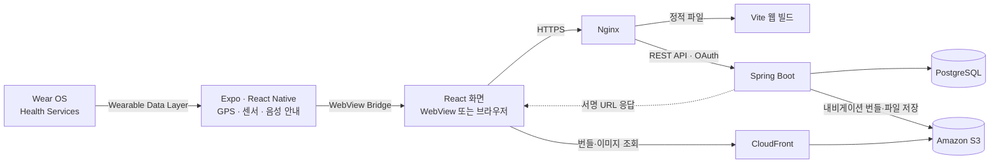

### 러닝 데이터 흐름

1. **수집** · 휴대폰은 GPS 위치를 읽습니다. 연결된 워치는 Health Services에서 받은 측정값을 Wearable Data Layer를 통해 휴대폰으로 보냅니다.
2. **표시** · 휴대폰이 WebView 브리지를 통해 위치와 측정값을 웹 화면으로 보냅니다. 일반·고스트 러닝은 코스 좌표에서 생성한 내비게이션 번들로 체크포인트와 음성 안내 시점을 계산합니다.
3. **저장** · 세션을 종료하면 API가 러닝 경로와 측정 데이터를 저장합니다. 완료된 세션은 활동 캘린더 집계와 포인트 적립 조건에 반영됩니다.

[GPS 브리지](web/docs/gps_bridge.md) · [워치 데이터 연동](web/docs/health-data-bridge.md) · [DB 스키마](DB/SCHEMA_GUIDE.md)

## 기술 스택

| 영역 | 기술 |
| --- | --- |
| Web | React 19 · TypeScript 5.9 · Vite 7 · Tailwind CSS 4 · TanStack Query · Zustand · Kakao Maps |
| Mobile | Expo SDK 54 · React Native 0.81 · React Native WebView · WebView Bridge |
| Wear OS | Kotlin · Jetpack Compose for Wear OS · Health Services · Wearable Data Layer |
| Backend | Java 21 · Spring Boot 3.5 · Spring Data JPA · QueryDSL · Spring Security · OAuth 2.0 · JWT |
| Data & Infra | PostgreSQL · Amazon S3 · CloudFront · AWS Systems Manager Parameter Store · Docker Compose · Nginx · GitLab CI/CD |

## 로컬 실행

웹과 모바일은 각 디렉터리에서 pnpm으로 설치합니다. 웹이 모바일의 브리지 타입을 참조하므로 저장소 전체를 체크아웃한 상태에서 실행합니다.

### 백엔드

JDK 21과 PostgreSQL이 필요합니다. 기본 설정은 AWS Systems Manager Parameter Store의 `/config/withrun/`에서 DB 접속 정보, OAuth 설정, JWT 및 파일 저장 설정을 읽습니다. 해당 경로를 읽을 수 있는 AWS 자격 증명과 접속 가능한 DB를 설정한 뒤 실행합니다. [Spring 설정](was/src/main/resources/application.yml) · [DB 스키마 SQL](DB/schema.sql)

```bash
cd was
./gradlew bootRun
```

기본 포트는 `8080`입니다. 테스트는 같은 디렉터리에서 `./gradlew test`로 실행합니다.

### 웹

Node.js 20.19 이상(20.x) 또는 22.12 이상과 pnpm을 사용합니다. `VITE_API_BASE_URL`에 백엔드 주소를 지정하고, 백엔드의 `app.auth.allowed-origins`에 웹 주소를 추가합니다.

```bash
cd web
pnpm install
VITE_API_BASE_URL=http://localhost:8080 pnpm dev
```

브라우저에서 `http://localhost:5173`에 접속합니다. 프로덕션 빌드는 `pnpm build`로 확인할 수 있습니다.

### 모바일과 워치

휴대폰에서 로컬 웹에 접속하려면 웹 서버를 `pnpm dev --host 0.0.0.0`으로 열고, `mobile/.env.local`의 `EXPO_PUBLIC_WEB_HOST`에 개발 PC의 LAN IP를 지정합니다. 웹의 `VITE_API_BASE_URL`도 휴대폰이 접근할 수 있는 주소로 설정하고, 백엔드에서 웹의 LAN 주소를 허용합니다.

```bash
cd mobile
pnpm install
pnpm android
```

iOS 개발 빌드는 Xcode 환경에서 `pnpm ios`로 실행합니다. Wear OS 연동은 `watch/`를 Android Studio에서 열어 빌드하고, 같은 앱 ID와 서명으로 빌드한 휴대폰 앱이 설치된 Android 기기와 페어링해 확인합니다. [모바일 실행 안내](mobile/AGENTS.md) · [워치 빌드 안내](watch/AGENTS.md)

## 프로젝트 구조

| 경로 | 역할 |
| --- | --- |
| [`web/`](web/) | 사용자 화면, 라우팅, 지도와 러닝 상태 표시 |
| [`mobile/`](mobile/) | Expo WebView, 위치·센서 권한, 음성 안내, 네이티브 브리지 |
| [`was/`](was/) | 인증, 코스 추천, 러닝 세션, 캘린더, 리워드 API |
| [`watch/`](watch/) | Wear OS 운동 세션과 센서 데이터 수집 |
| [`DB/`](DB/) | PostgreSQL 스키마와 도메인별 데이터 설계 |
| [`deploy/`](deploy/) | 환경별 Docker Compose와 Nginx 설정 |
| [`infra/local/valhalla/`](infra/local/valhalla/) | Valhalla 라우팅 엔진 로컬 실행 환경 |

## 협업 규칙

<details>
<summary>브랜치, 리뷰, 커밋 규칙 보기</summary>

- 작업 브랜치는 `dev`에서 분기하고 `dev`를 대상으로 MR을 엽니다. 브랜치명은 `feat/<scope>/<short-desc>`, `fix/<scope>/<short-desc>`, `hotfix/<scope>/<short-desc>` 형식을 권장합니다.
- MR에는 변경 범위, 테스트 결과, 관련 이슈, UI 변경 시 캡처를 남깁니다. 변경이 500줄을 넘으면 기반 작업, 기능, UI 변경 단위로 분리를 검토합니다.
- 다른 팀원 1명 이상에게 승인을 받습니다. 변경 영역을 담당하는 리뷰어의 참여를 권장합니다. 작성자가 최신 `dev`를 기준으로 충돌을 해결하고 테스트한 뒤 rebase merge 합니다. 긴급 수정이나 작성자 부재 시에는 대리 병합할 수 있습니다.
- 커밋 메시지는 `type(scope) : message` 형식을 사용합니다. MR 제목은 `[Feat(WAS)] 러닝 세션 조회 API 추가`처럼 작성합니다. [MR 템플릿](.gitlab/merge_request_templates/default.md)

</details>
